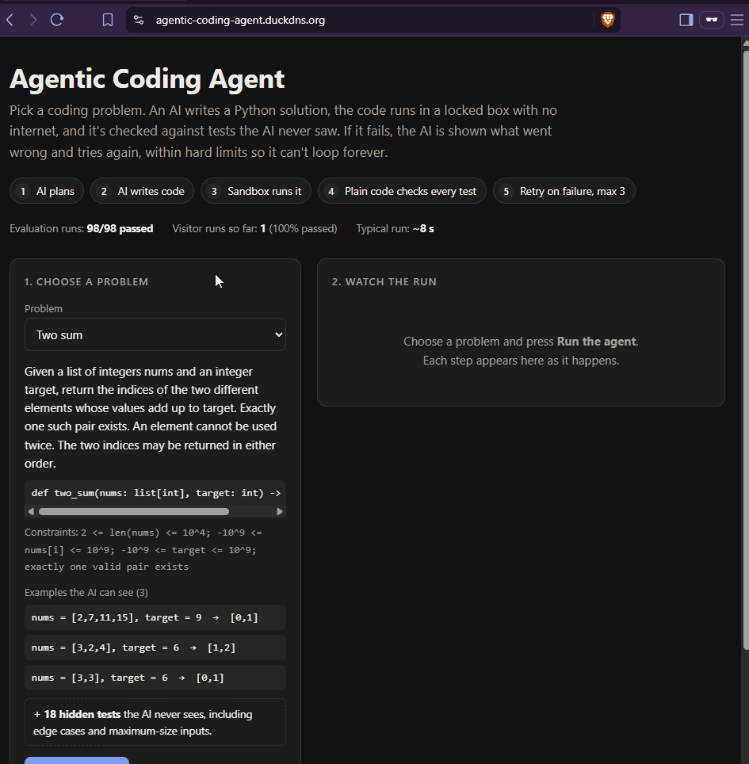

# Agentic Coding Agent

An autonomous agent that takes an algorithm problem, plans, writes Python, runs it in a
resource-limited Docker sandbox, checks it against tests, and retries with the failure fed
back, under hard step, retry and token limits so it can't run away. It's served as a small
public API with a fixed task catalog, per-IP rate limiting and live stats.

**In plain English:** you pick a coding problem. An AI writes a solution, the code runs inside a
locked box with no internet, and it's checked against tests the AI never saw. If it fails, the AI
is shown what went wrong and tries again, up to a fixed limit, so it can't loop forever or run up
costs.

**Try it:** [agentic-coding-agent.duckdns.org](https://agentic-coding-agent.duckdns.org). Pick a
problem, press Run, and watch the agent plan, write code, get tested and retry, step by step.



| Evaluation (3 runs per task) | Result |
|---|---|
| 18 classic problems (7 easy, 7 medium, 4 hard) | **18/18 tasks passed every run; 54/54 runs** |
| Cost and speed per run | ~1,000 tokens, ~3.4 s, 2 LLM calls (plan + write) |
| 4 twisted variants built to make the memorized answer wrong | 12/12 runs passed; **4 runs failed first and corrected themselves** |

The honest reading is in [Results](#results): the 18 classics are well known to the model, so
they show the system works end to end; the twisted variants are where self-correction shows up.

## Why this exists

LLM-generated code is unverified and can't be trusted to run. This system takes a task, writes
code, runs it in an isolated sandbox, checks it against tests, and self-corrects until it passes,
with hard limits so it can't run away.

It's a reliability and safety harness around an LLM, not a coding assistant: the interesting
parts are containment, limits, persistence and traceability, not the model call.

## How it works

1. **You send a task id** (one of 18 known problems) to the API.
2. **The API checks it**: is it a real task, and has your IP used up its 5 runs for today? Then
   it queues the run and immediately gives you a run id.
3. **The AI plans, then writes code.** It only sees the problem and a few example tests.
4. **The code runs in a fresh, locked-down container** against every test, including hidden ones.
5. **Plain code, not the AI, decides pass or fail.** On a failure, the AI sees what went wrong
   and tries again, at most 3 times.
6. **Every step is saved as it happens**, so you can follow the run at `/runs/{id}`, and a crash
   doesn't lose progress.

### Under the hood

```
browser (demo page) / CLI / curl
      |
      v
nginx :443 --> FastAPI: POST /runs, GET /runs/{id}, GET /tasks, GET /stats --> Postgres (runs, steps, rate_limits)
                    |
                    v  one background worker, one run at a time
      LangGraph loop:  Planner -> Worker -> execute_code -> Verifier --fail--> Worker (retry)
                    |                              |
                    v                              v
                Gemini API            Docker container per call
                                      (no network, 1 CPU, 512 MB, 100 processes, 10 s)
```

- **Planner** (LLM call): turns the task into a short plan, logged before anything runs.
- **Worker** (LLM call): writes the full solution. On a retry it gets its previous code, the
  failing visible test cases, and a count of failing hidden ones, and writes a one-line
  diagnosis before the fix.
- **Sandbox**: every attempt runs in a fresh, disposable container with no network and hard
  CPU, memory, process-count and time limits, enforced by Docker rather than by the agent.
- **Verifier** (plain code, no LLM): decides pass / retry / give up from per-test results. A
  pass is recomputed from the results, never trusted from a status string.
- **Limits**: 3 retries per task, 15 LLM calls per run, 100k tokens per run, all checked in code
  before every model call. Hitting one ends the run as `incomplete` with its full trace.
- **Persistence**: every step is written to Postgres as it happens; if the server dies mid-run,
  it resumes from the last saved step on restart instead of starting over.

## Safety

The public endpoint runs model-written code, so the design is about bounding what can go wrong:

- **Only a fixed catalog**: `POST /runs` accepts a `task_id` from the catalog and nothing else,
  so nobody can submit their own code or prompts.
- **Hidden tests**: about 88% of test cases are never shown to the model, not in the prompt, not
  in retry feedback, and not in anything the public API returns (task list or run trace). Each case's printed output and
  exceptions are captured separately so hidden inputs can't leak through error messages.
- **Rate limit**: 5 runs per IP per UTC day, counted in a single database step (so two requests
  at once can't both slip through) before any run or model call exists, so a rejected request
  costs nothing. Visitors can't fake their IP to get around it.
- **Sandbox limits**: no network, 512 MB, 1 CPU, 100 processes, 10 s. The process cap was added
  after a fork bomb outlived `docker kill` in testing.
- **One run at a time**: a single worker marks each run as taken in one database step before
  starting it, so a run is never executed twice.

## Try it

**In a browser:** open [the demo page](https://agentic-coding-agent.duckdns.org), choose a
problem and press **Run the agent**. The run appears step by step: the plan, each code attempt,
which tests passed, and the AI's diagnosis on a retry. It has a shareable link (`?run=<id>`).
There's also a recorded run where the first two attempts fail and the third fixes it. The page
is one static HTML file that only calls the public API below; nothing is hidden behind it.

**From the command line:** all runs are rate-limited to 5 per IP per day. Valid task ids:
`two_sum`, `valid_parentheses`, `reverse_integer`, `merge_two_sorted_lists`, `maximum_subarray`,
`climbing_stairs`, `best_time_to_buy_sell_stock`, `group_anagrams`,
`longest_substring_without_repeating`, `three_sum`, `binary_tree_level_order_traversal`,
`course_schedule`, `coin_change`, `number_of_islands`, `lru_cache`, `merge_k_sorted_lists`,
`trapping_rain_water`, `word_ladder`.

Submit a run (returns immediately with a `run_id`):

```bash
curl -X POST https://agentic-coding-agent.duckdns.org/runs -H "Content-Type: application/json" -d '{"task_id":"two_sum"}'
```

Follow it (status goes `queued` -> `running` -> `passed` / `incomplete` / `error`; the trace shows
the plan, each code attempt, test results for the visible cases, and any retries):

```bash
curl https://agentic-coding-agent.duckdns.org/runs/<run_id>
```

List the problems with their visible examples (`GET /tasks`), or see aggregate numbers (the
`public` block counts visitor runs only):

```bash
curl https://agentic-coding-agent.duckdns.org/tasks
curl https://agentic-coding-agent.duckdns.org/stats
```

PowerShell equivalent of the first command:

```powershell
Invoke-RestMethod -Method Post -Uri https://agentic-coding-agent.duckdns.org/runs -ContentType "application/json" -Body '{"task_id":"two_sum"}'
```

## Results

Measured with `scripts/run_eval.py`, which submits every task 3 times through the API and stores
each batch with the command, git commit and model that produced it. Model:
`gemini-3.5-flash-lite` (free tier).

**Main set (18 tasks x 3 runs):** 54/54 runs passed, every task in every repeat; 2.0 LLM calls,
~1,046 tokens and ~3.4 s per run; 0 retries. These are classic LeetCode-style problems the model
has almost certainly seen in training, so this measures first-attempt correctness on familiar
problems and the whole pipeline end to end, not self-correction. It also means this eval is
saturated: it can't tell a better agent from a worse one.

**Stress set (4 twisted variants x 3 runs):** problems with a rule changed so the memorized
answer is wrong (e.g. trapping rain water where height-0 bars are drains). 12/12 passed; 4 runs
failed their first attempt and recovered (5 retries in total). In all three runs of one task the
first attempt made the same mistake, saw the failing visible example plus a count of failing
hidden ones, and fixed it, including hidden cases it was never shown. 12 runs is a small sample,
and the model's written diagnoses aren't always an accurate explanation even when the fix works.

**How the tests are built:** expected outputs come from the owner's own solutions, run through
the same harness code that grades the agent and cross-checked against an independently written
brute force, never from a model. Max-size cases were measured against deliberately naive
solutions: they catch them for some tasks (e.g. maximum subarray, coin change, three sum) and not
for others, where the problem's own limits still let the slow approach finish in time.

## Run it yourself

The real task catalog (with hidden test cases) isn't published, so a clone runs against a small
example catalog with one toy task.

Requirements: Python 3.11+, Docker, a Postgres database (a free [Neon](https://neon.tech)
project works) and a [Gemini API key](https://aistudio.google.com/apikey) (free tier).

```bash
git clone <this repo> && cd agentic-coding-agent
python -m venv .venv && source .venv/bin/activate      # Windows: .venv\Scripts\activate
pip install -e ".[dev]"
docker build -t agentic-sandbox:latest docker/sandbox

cp .env.example .env
# edit .env: set GEMINI_API_KEY and DATABASE_URL, and uncomment
# TASK_CATALOG_PATH=examples/task_catalog.example.json

python scripts/migrate.py                               # create the tables
uvicorn agentic_coding_agent.api.app:app                # demo page + API on http://127.0.0.1:8000
```

Then, in another terminal:

```bash
curl -X POST http://127.0.0.1:8000/runs -H "Content-Type: application/json" -d '{"task_id":"sum_list"}'
curl http://127.0.0.1:8000/runs/<run_id>
```

Tests: `pytest`. Most of the suite needs Docker and a database; tests that need the private
catalog or a live model skip themselves (live model tests run only with `RUN_LIVE_LLM=1`).

## Deployment

One GCP e2-micro VM (free tier) running Ubuntu 24.04: uvicorn as a single systemd service bound
to localhost, nginx in front with HTTPS (a free Let's Encrypt certificate that renews itself), Docker for the sandbox, a 2 GB swap file, and only SSH,
HTTP (redirects to HTTPS) and HTTPS open. Under the heaviest tasks it peaks around 670 MB of its 953 MB of RAM. Postgres is
hosted on Neon; secrets live only in an env file on the VM.

## Limitations

- "Verified" means it passes these test cases, not that a solution is correct for all inputs.
- Tests check correctness, and efficiency only where a problem's limits make naive solutions
  time out; the LRU task's O(1) requirement isn't enforced.
- Python only; single-function algorithm problems, not repository-level tasks.
- Sequential: one run at a time.
- Depends on Gemini's free tier; heavy traffic exhausts it.
- Docker shares the host kernel; not hardened for hostile multi-tenant use.
- Per-IP rate limiting is easy to evade.
- The success rate is on 18 tasks I chose, so it's not a general benchmark.
- Resume re-runs the interrupted step; it doesn't resume a container mid-execution.
